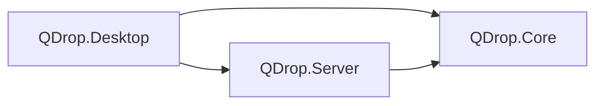

# Initial architecture

## Current scope

This is an organizational scaffold: three .NET 10 projects, explicit project references, reserved folders, and shared build settings.

All three projects are currently empty class libraries. There is no desktop entry point, window, HTTP host, business implementation, or test suite. The desktop project will become an Avalonia executable when application bootstrap work begins.

## Project boundaries

| Project | Intended responsibility | Project dependencies |
| --- | --- | --- |
| `QDrop.Core` | Business models, sharing rules, session management, and contracts | None |
| `QDrop.Server` | Embedded HTTP host, endpoints, download streaming, and mobile download page | `QDrop.Core` |
| `QDrop.Desktop` | Avalonia views, view models, desktop integration, and application composition | `QDrop.Core`, `QDrop.Server` |



Arrows represent project references. Core must remain independent of Avalonia, ASP.NET Core, and the other QDrop projects. Server must not reference Desktop.

Desktop will be the composition root: it will assemble services and own the application lifetime. Views will present state and forward user actions through view models. Business decisions belong in Core; HTTP request and response handling belongs in Server.

## Folder responsibilities

```text
QDrop/
├── branding/                  Existing visual identity and logo exports
├── docs/
│   └── architecture.md       Project boundaries and organization
├── src/
│   ├── QDrop.Core/
│   │   ├── Models/           Business data and session models
│   │   ├── Interfaces/       Contracts required across boundaries
│   │   └── Services/         Business operations and validation
│   ├── QDrop.Desktop/
│   │   ├── Views/            Avalonia XAML views and minimal code-behind
│   │   ├── ViewModels/       Presentation state and commands
│   │   ├── Controls/         Reusable desktop controls
│   │   ├── Styles/           Themes and shared visual resources
│   │   └── Assets/           Runtime desktop assets
│   └── QDrop.Server/
│       ├── Endpoints/        HTTP route mappings
│       ├── Services/         Hosting and transport operations
│       └── Web/              Locally served download page assets
├── tests/                    Reserved for future automated tests
├── scripts/                  Reserved for future build and release scripts
├── Directory.Build.props     Shared .NET settings
├── global.json               .NET 10 SDK selection
└── QDrop.sln                 Solution containing the three projects
```

Empty folders are tracked with `.gitkeep` files. Introduce classes and interfaces only when an actual feature requires them; the reserved folders are not a requirement to invent abstractions.

## Planned technology placement

- **Desktop:** Avalonia UI, XAML, MVVM, and CommunityToolkit.Mvvm.
- **Server:** ASP.NET Core Minimal API and Kestrel, embedded in the desktop process.
- **Core:** framework-independent business logic, using .NET libraries where appropriate.
- **Composition and diagnostics:** Microsoft.Extensions.DependencyInjection and Microsoft.Extensions.Logging, added when application bootstrap requires them.
- **QR codes and ZIP downloads:** introduced in the relevant services when those features are developed.

No external packages are installed in this scaffold. Package versions and their final placement will be selected when the corresponding work begins. Keep the dependency direction above and avoid introducing a separate layer or package without a concrete need.

## Deferred decisions

Session concurrency, editing files during an active share, expiration during an in-flight download, and platform-specific distribution will be decided before implementing those behaviors.

BDD, TDD, test projects, and executable behavior specifications are also deferred until feature development begins.

## Build the scaffold

Install a stable .NET 10 SDK, then run from the repository root:

```sh
dotnet restore QDrop.sln
dotnet build QDrop.sln --no-restore
```

These commands validate the project scaffold. There is no application to run yet.
