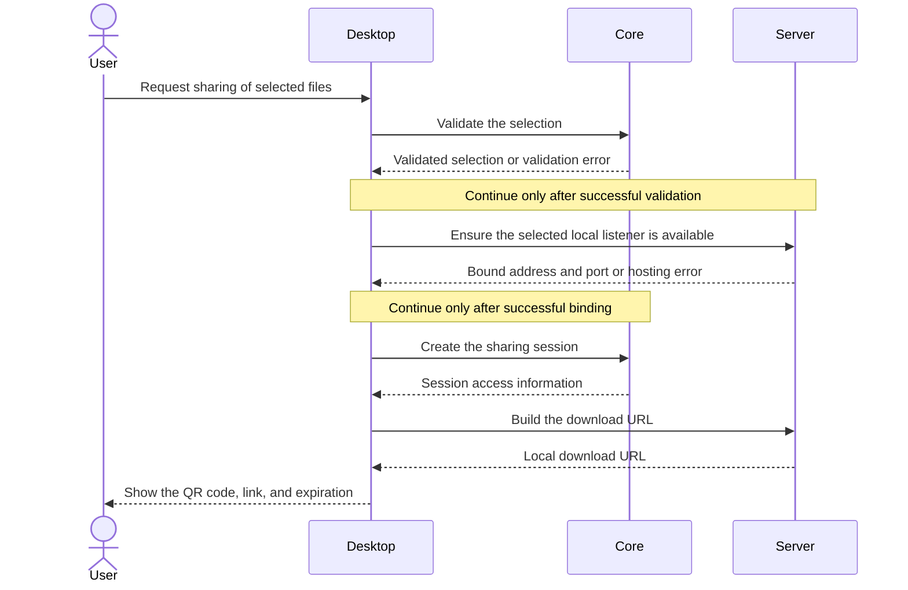

# Layer contracts and application flow

## Scope

This document refines the [initial architecture](architecture.md). It describes responsibilities and information exchanged between layers; it does not introduce C# interfaces, implementations, test cases, or new dependencies.

The contracts below are design boundaries. Exact types and method signatures will be introduced with the features that require them.

## Ownership

| Concern | Owner | Boundary |
| --- | --- | --- |
| File picker, drag and drop, clipboard, and window state | Desktop | Convert desktop interactions into requests; keep Avalonia types inside Desktop. |
| Selected-file metadata and validation rules | Core | Work with application data, independently of views and HTTP requests. |
| Session creation, tokens, expiration, and revocation | Core | Keep one authoritative source for whether a session permits access. |
| Network interface discovery, port binding, and server lifetime | Server | Return the address actually bound; keep hosting types inside Server. |
| Download URL construction and HTTP responses | Server | Translate session information into network-facing behavior. |
| QR rendering and link presentation | Desktop | Generate the visual representation of the URL supplied by Server. |
| File and ZIP streaming | Server | Read only files authorized by Core and manage the streams used by each request. |
| Service assembly and application shutdown | Desktop | Coordinate Core and Server from the application composition root. |

View models should use business contracts for business operations. The Desktop reference to Server is intended for composition and transport coordination; views should not construct hosts or map endpoints.

## Information boundaries

### Files

Desktop may pass local file paths to Core after the user selects them. Core will validate the selection and associate each accepted file with an internal identifier.

The approved file information used inside the process may include a local path. Its public projection must contain only the identifier, display name, and size. Local paths must not appear in download URLs, HTTP payloads, or user-facing errors.

Server will resolve a requested file identifier within an authorized session. A path supplied by an HTTP client must never become a filesystem lookup.

### Sessions

Core will own the selected-file association, token, expiration time, and revocation state. Server will consult that authority before granting access instead of maintaining a separate set of session rules.

Desktop will receive the information needed to show a sharing link, remaining time, and status. Tokens are sensitive session data and must not be included in diagnostic logs.

### Hosting

Desktop will supply the selected network interface and preferred port to Server. Server will return the address and port actually in use, including any port fallback.

HTTP context objects, Kestrel configuration, and endpoint response types remain in Server. Core must not acquire an ASP.NET Core dependency through these contracts.

## Preparing a share

The steps describe coordination, not a prescribed set of interfaces. Stop at a failed preparation step and release resources created by that attempt. An unsuccessful attempt must not leave a hidden active share.

## Serving a download

1. Server receives a token and, for an individual download, an internal file identifier.
2. Core checks the session and whether the requested file belongs to it.
3. Server opens only the authorized file and streams the response, or returns an appropriate unavailable-file response.
4. Server disposes request resources on completion, cancellation, or disconnection.

HTTP request parsing and response mapping belong in Server. Access decisions belong in Core. Transport progress and errors must reach Desktop as application data, without exposing HTTP or Avalonia objects across layers.

## Decisions still open

- Whether version 1.0 permits one active sharing session or multiple sessions.
- Whether changing the selection affects an active share or requires a new share.
- Whether expiration lets downloads already in progress finish.
- Whether manual revocation cancels downloads already in progress.

These choices remain open product decisions. The ownership and flow above must not be treated as approval of a specific policy.
